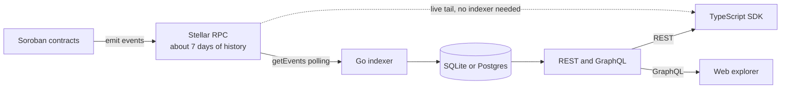

<p align="center">
  <a href="https://www.npmjs.com/package/@pulsar-stellar/sdk"></a>
  <a href="https://github.com/pulsar-stellar/pulsar-app/blob/main/LICENSE"></a>
  <a href="https://hub.xerj.org/contributors/EmeditWeb"></a>
</p>

# Pulsar Stellar

Read Soroban contract events past the 7-day RPC retention window.

## The problem

Stellar RPC keeps about seven days of contract events, so anything older is gone from `getEvents`. A project that needs its full history ends up writing the same plumbing every time: an XDR decoder, an indexer, and an API on top. Pulsar is that plumbing, built once: it stores every event a contract emits, decodes it into typed data, and serves it to your app or to a browser.

## How it fits together



The indexer polls RPC, decodes each event, and keeps it for good. The SDK reads that history from the indexer, or tails new events straight from RPC when you don't run one. Both paths return the same event type.

## Repositories

| Repository | What it holds |
|---|---|
| [pulsar-app](https://github.com/pulsar-stellar/pulsar-app) | The TypeScript SDK, the Go indexer, and the Next.js explorer |
| [pulsar-core](https://github.com/pulsar-stellar/pulsar-core) | The Rust event decoder and the reference contract whose events every part is tested against |
| pulsar-docs | The documentation source, published at [emeditweb.gitbook.io/pulsar-stellar-sdk](https://emeditweb.gitbook.io/pulsar-stellar-sdk) |

## Get started

```sh
npm install @pulsar-stellar/sdk @stellar/stellar-sdk
```

`@stellar/stellar-sdk` is a required peer dependency. Read the [documentation](https://emeditweb.gitbook.io/pulsar-stellar-sdk) for usage.

## Status

- `@pulsar-stellar/sdk` 0.2.0 is on npm.
- The indexer, the explorer, and the Rust decoder are built and tested. The decoder is not on crates.io yet.
- The reference contract is deployed on Stellar testnet.
- Public hosting of the indexer and explorer is in progress. Today you run them yourself.

## Contributing

Contributions start in pulsar-app. Read its [CONTRIBUTING.md](https://github.com/pulsar-stellar/pulsar-app/blob/main/CONTRIBUTING.md) before opening a pull request.
